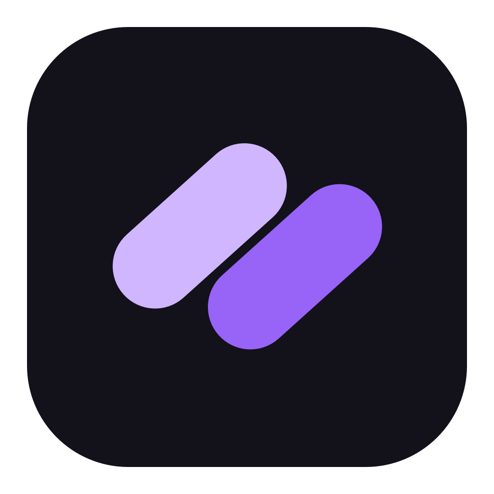
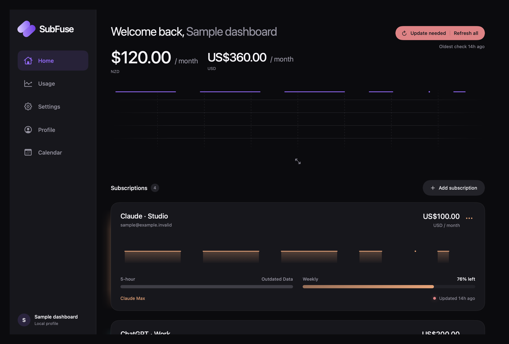
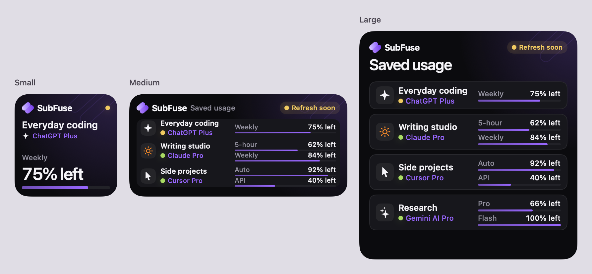
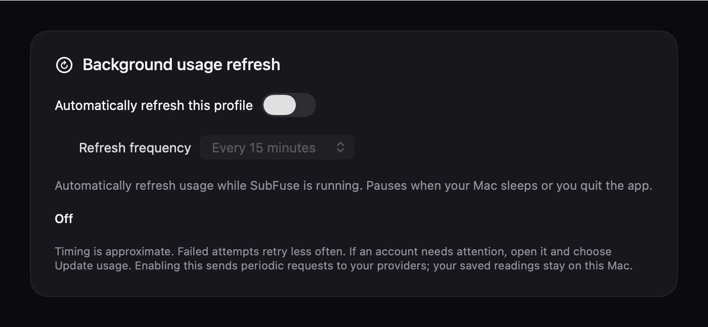

<h1 align="center">SubFuse</h1>

<strong>Your AI subscriptions. One clear view.</strong> Usage, costs, and renewals together on your Mac.

<strong>Currently compatible with Claude, ChatGPT, Cursor, and Gemini via Antigravity.</strong> Free download · Apple Silicon · macOS 14 or later · Proprietary software

<a href="https://github.com/cohenfreeland/SubFuse-Beta/releases/tag/v1.0">Download SubFuse 1.0</a> · <a href="https://github.com/cohenfreeland/SubFuse-Beta/issues">Report a problem</a> · <a href="PRIVACY.md">Privacy</a>

SubFuse is a native Mac app for people juggling multiple AI subscriptions. See how much allowance remains, when usage resets, and what you spend each month. Give each subscription a useful name, keep accounts organized in local profiles, and plan upcoming payments in a calendar.

## What you can do

- **See usage history at a glance**, with compact provider graphs, a clean expandable total graph, and rolling week, month, six-month and year views on Home.
- **Compare observed usage** in Combined Usage with monthly, six-month and yearly views. Credits normalize supported weekly allowances: 100 credits represent one base-plan allowance. They are not provider tokens or money.
- **Review subscription efficiency**, including observed used and unused allowance and eligible unused-value estimates for completed weekly periods. Incomplete history and unsupported plans stay explicitly unavailable.
- **Build daily history** with a separate 9 AM collection task, with pause and removal controls in Settings. Manual refresh also records observations; periodic background refresh keeps current bars fresh.
- **Keep the interface focused**, with three-dot subscription settings, brand-coloured accents and widgets, and matching renewal colours in the calendar.

- **See remaining usage** across supported accounts, with reset times and clear indicators when readings need a refresh.
- **Check saved usage on your desktop** with a small, medium, or large widget. Select a subscription to open its details in SubFuse.
- **Refresh with one click** using remembered Claude and Cursor sign-ins, with connection steps shown only when needed. Antigravity opens in the background for manual refresh when required.
- **Refresh all subscriptions** from the top-right status pill. Successful accounts update even when another needs attention.
- **Refresh usage automatically** every 5, 15, 30, or 60 minutes while SubFuse is running, with optional settings for each local profile.
- **Keep multiple accounts together**, with custom names and the provider's plan shown separately.
- **Track your spending** with manually entered amounts and currencies. Different currencies stay separate.
- **Plan renewals and trials** with a calendar and optional Mac notifications.
- **Remember Claude and Cursor sign-ins** in separate website sessions for your local profiles and accounts.
- **Copy a profile to another Mac** with a password-protected file that includes saved subscriptions and remembered Claude/Cursor website sessions. This is not sync.
- **Choose light, dark, or system appearance.**
- **Update inside the app** using **SubFuse → Check for Updates…** or **Settings → App updates**.

## Upgrading from SubFuse Beta

In Beta 0.9 or later, choose **SubFuse → Check for Updates…** (the menu may still say SubFuse Beta), then install SubFuse 1.0. Profiles, subscriptions, remembered Claude/Cursor sign-ins, costs, renewal settings and background-refresh preferences use the same storage and app identity. Existing widgets keep their identity too. History begins with new readings; past usage is not backfilled.

The updater may keep the existing **SubFuse Beta.app** filename in Applications. The app inside is SubFuse 1.0; check its displayed version. New downloads are named **SubFuse.app**. Keep one installed copy.

Private V2/1.0 previews used separate storage. To retain a preview profile and its history, use its password-protected **Copy to another Mac…** export and restore the file in the full release. This does not overwrite Beta profiles. Provider sessions can expire and may need another sign-in.

The public repository keeps its `SubFuse-Beta` address so installed apps continue receiving updates. The product is now SubFuse.

## Copy a profile to another Mac

In **Profile**, choose **Copy to another Mac…** beside a saved profile. Choose where to save the `.subfuse` file, then enter and confirm a password. Copy that file yourself. On the destination Mac, create or open a local SubFuse profile, choose **Profile → Restore from another Mac…**, select the file and enter its password.

- The file includes that one profile’s subscriptions, saved usage readings, history, costs and renewal dates, plus its remembered **Claude and Cursor website sessions**. Other profiles and their website data are left out.
- **ChatGPT and Gemini** subscriptions come back as saved rows. Their usage still refreshes through the ChatGPT and Antigravity desktop apps signed in on the destination Mac.
- The restored profile is added beside existing profiles without switching to it. A sign-in already on that Mac is never overwritten; SubFuse reports the collision instead.
- A provider can expire or revoke a session or ask you to sign in again. A live Claude/Cursor session transfer between two Macs has not yet been verified; release testing used synthetic stores and an isolated WebKit cookie marker.

SubFuse must be idle, with scans, refreshes and connection windows finished. If the selected website sessions were used during this launch, turn off scheduled refresh, quit and reopen SubFuse, then copy before refreshing. This lets WebKit finish saving its data.

The archive is encrypted and website data is limited to 200 MB. SubFuse does not upload the file or store its password, and there is no password recovery. **Anyone with both the file and password can use its included sessions.** Keep them secure and separate. A wrong password or changed file restores nothing. This is a file you copy yourself, **not sync**.

## Supported providers

| Provider | What SubFuse reads | What you need |
| --- | --- | --- |
| Claude | Available session, weekly, and model-specific allowance windows | Sign in through SubFuse's connection window and select your workspace |
| ChatGPT | The Work / Codex allowance pool, with the usage windows your account reports | The ChatGPT/Codex desktop app installed and signed in to the matching account |
| Cursor | Included usage reported by your account dashboard, including supported unified subscriptions | Sign in through SubFuse; use **Grok / unified sign-in** when your account uses that dashboard |
| Gemini via Antigravity | Allowance pools and resets reported by Antigravity, including model families when supplied | Install Antigravity and sign in to the matching Google account; manual refresh opens it if needed |

These four providers are supported. Ordinary ChatGPT chat-message limits and Gemini consumer-chat/API limits are not included. Unified Cursor usage may be shared with other eligible products; it is not a Cursor-only activity meter. Some accounts do not expose allowance readings, in which case SubFuse shows **Unavailable**.

## Install on your Mac

1. Download **SubFuse-1.0-macOS-arm64.zip** from the [1.0 release](https://github.com/cohenfreeland/SubFuse-Beta/releases/tag/v1.0). GitHub's automatic “Source code” downloads contain this public documentation, not the application.
2. Unzip it and move **SubFuse.app** into **Applications** before opening it.
3. Open the app, choose **Sign in**, and create a local profile. This profile lives on your Mac; it is not a cloud account.
4. Choose **Add subscription**, select Claude, ChatGPT, Cursor, or Gemini, and follow the connection steps.
5. Open a subscription to enter its cost, currency, and renewal date.

**This release is not Apple-notarized or Developer ID signed.** macOS may initially block it. If you trust this download, first attempt to open it, then go to **System Settings → Privacy & Security → Open Anyway**, and confirm **Open**. See [Apple's opening instructions](https://support.apple.com/en-us/102445). Do not disable Gatekeeper globally. Managed Macs may not allow an exception.

Intel Macs, Windows, Linux, iPhone, and iPad are not supported.

## Saved usage widget

Open the macOS widget gallery and add **SubFuse → Saved usage**. Small shows the subscription in your active profile whose reading most needs attention. Medium and Large show more subscriptions in the same order. Select a subscription to open its detail sheet.

The dark widgets use the dashboard’s Fuse mark, provider icons, and provider-coloured bars to show how much allowance remains. A dashed track marks expired or unavailable readings. The small widget gives a single current reading more space.

The widget reads usage already saved by the app. A freshness dot can change while SubFuse is closed, and a reading becomes **Outdated Data** when its saved reset time passes. Open the app to refresh the reading.

If macOS can’t provide shared storage, the widget reads the saved SubFuse profile file in Application Support. The widget has read-only access to that one fallback file.

## Refresh your subscriptions

Choose **Update usage** in a subscription to get a fresh reading. Claude and Cursor first try the remembered account in the background; their connection window opens only if that attempt needs help. ChatGPT uses the matching account signed in to the desktop app. Gemini uses the matching account in Antigravity. Update usage and Refresh all open Antigravity in the background if needed, wait for its account service, then update the reading.

Click **Refresh all** in the top-right status pill to try every subscription in the current profile. SubFuse saves the readings it can get and skips accounts needing input, without interrupting you with sign-in windows. If any fail, it says **Not all subscriptions could be refreshed.** Open an affected subscription and choose **Update usage** to reconnect. Failed updates preserve the last saved reading.

## Connect Gemini through Antigravity

Open Antigravity and sign in to your Google account, then choose **Add subscription → Gemini → Connect subscription** in SubFuse. Update usage and Refresh all now open Antigravity in the background if needed and wait for it to be ready. An already-running instance is reused, and Antigravity stays running afterward. Scheduled refreshes require Antigravity to be running. If multiple distinct accounts are running, leave the intended one open and retry.

Gemini supports custom names, manual costs/currencies, renewals, trials, calendar reminders, and **Nothing’s changed**, just like the other subscriptions. You can save multiple accounts; the matching account must be active in Antigravity to refresh each one. Failed or mismatched updates keep the previous reading.

The bars represent Antigravity allowances, including other model families when reported, rather than Gemini consumer-chat/API limits or a separate Claude subscription. Missing data stays unavailable; older versions may return cached readings. **Checked Antigravity** is the time SubFuse checked the service, not an upstream measurement timestamp. Relative reset descriptions are shown as **At last check**; only explicit reset dates can trigger an expired-reset indicator.

**Automatic startup verified live with Antigravity 2.29.0 and a Starter Quota account.** Starting from a fully closed Antigravity app, Update usage opened it and refreshed both allowance pools. Earlier integration checks used Antigravity 2.28.2 and included restarting SubFuse. Version 0.12.1 repairs connections to its standalone HTTP runtime while retaining verified-process, loopback, and account safeguards. Other versions, plans, and enterprise/project-specific entitlements remain unverified; the internal desktop interface can change. Account matching uses a hash of the reported email: an email change needs a new subscription, and a reassigned organizational email cannot be distinguished.

SubFuse does not own a Google sign-in. Removing Gemini or deleting a local profile does not sign out of Antigravity or cancel your plan; **Forget sign-in** applies to Claude and Cursor website sessions.

## Background usage refresh

Open **Settings → Background usage refresh** and turn on **Automatically refresh this profile**. Choose **5, 15, 30, or 60 minutes**. The feature is off by default, with 15 minutes selected, and each local profile remembers its own choice.

Enabling starts a quiet refresh when idle. It continues while SubFuse is running, even when another app has focus. It pauses when your Mac sleeps and stops when you quit SubFuse. Returning after missed intervals makes at most one overdue attempt; it does not replay them all or wake your Mac. Timing is approximate, and repeated failures retry less often.

Only the active profile is refreshed. Manual refreshes and connection windows take precedence. Automatic refresh never opens a sign-in window or launches Antigravity; successful accounts update and failed accounts keep their previous readings. Settings shows the last attempt, how many subscriptions refreshed, and the last fully successful refresh. Open an affected subscription and choose **Update usage** to reconnect.

Turn the toggle off to stop scheduled and in-progress automatic work. Your selected frequency is retained. Automatic refresh makes periodic requests to your providers; preferences and readings stay on this Mac.

## History, credits and efficiency

History uses comparable provider readings rather than a continuous activity log. A first reading establishes a baseline. Missing observations, unknown resets, counter decreases and plan changes create gaps; they are not treated as zero. Credits compare allowance consumption using supported plan multipliers, not identical computing power across providers. ChatGPT Pro 100 is supported at 10×.

Efficiency estimates require usable weekly observations. Monetary estimates additionally require a known, stable manually entered price and an eligible allowance pool; they are not billing records or promised savings. Separate currencies remain separate. See the [FAQ](https://subfuse.cohenfreeland.chatgpt.site/faq.html) for calculation details.

Daily history collection is separate from periodic background refresh. SubFuse registers a macOS task for 9 AM local time that can launch it quietly while closed. Collection requires a logged-in Mac and available sessions/services, does not wake the Mac, and can be delayed by sleep. Settings can pause collection or remove the task; reopening registers the task again, while a saved pause stays in effect. Missed data is not backfilled.

## Staying up to date

Usage refresh is separate from the app-update checks described here.

Version 0.9 and later include the built-in updater. It checks GitHub for updates while the app is running; automatic checks can be turned off in Settings. You choose when to download, install, and restart. Update packages are verified with SubFuse's signing key before extraction. These update signatures are separate from Apple's notarization.

If you use 0.8 or earlier, install 1.0 manually to get the updater. Quit the old app before replacing it. Existing saved profiles carry forward automatically. Keep one installed copy in Applications for future updates.

## A few things to know

Usage is a saved snapshot, not a continuous live meter. Choose **Update usage** for a fresh reading. **Nothing's changed** confirms that you have not used an account since its last reading; it does not contact the provider. After a reset passes, update the account before relying on the bar.

Costs, billing dates, and trial dates are entered by you. SubFuse does not collect invoices, process payments, cancel subscriptions, or purchase credits. Calendar entries are estimates based on your schedule. On-demand spend and usage credits are not treated as included quota.

Provider websites and local account services can change. A connection failure keeps the last saved reading. Not every plan or workspace has been tested with a live account.

## Your data stays under your control

Profiles, saved readings, costs, and renewal schedules are stored on your Mac. Claude and Cursor authentication stays in local WebKit website stores. SubFuse does not upload your dashboard to a SubFuse server, and it has no cross-device sync or built-in analytics. Providers receive requests when you connect or refresh; GitHub receives update/download requests. See the [privacy notes](PRIVACY.md).

Local profiles help organize accounts; they are not password-protected security boundaries.

## Feedback and licensing

[Open an issue](https://github.com/cohenfreeland/SubFuse-Beta/issues/new/choose) with your app version, macOS version, provider, and steps to reproduce. Remove account emails, cookies, tokens, and personal information from screenshots and logs.

SubFuse is free to download and use, with proprietary source code. This public repository holds product documentation and release information only. See [LICENSE](LICENSE) and [third-party notices](THIRD-PARTY-NOTICES.txt).

SubFuse is an independent project and is not affiliated with or endorsed by Anthropic, OpenAI, Google, Cursor, or xAI. Product names belong to their respective owners.
