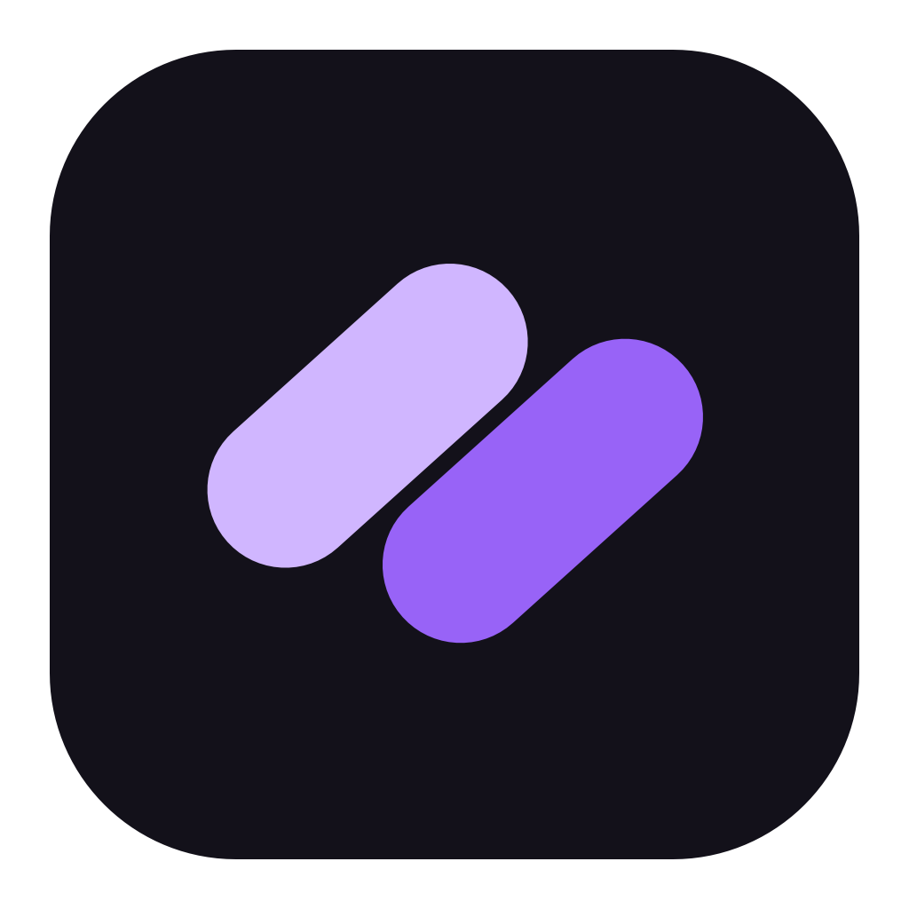
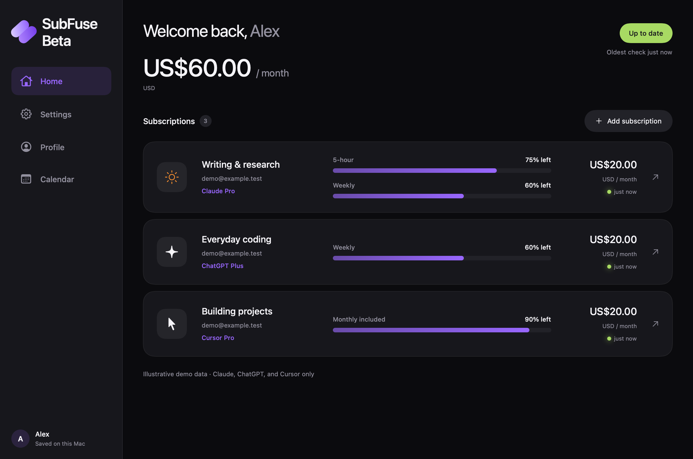

<h1 align="center">SubFuse Beta</h1>

<strong>Your AI subscriptions. One clear view.</strong> Usage, costs, and renewals together on your Mac.

<strong>Currently compatible with Claude, ChatGPT, and Cursor only.</strong> Free download · Apple Silicon · macOS 14 or later · Proprietary software

<a href="https://github.com/cohenfreeland/SubFuse-Beta/releases/tag/v0.9">Download SubFuse Beta 0.9</a> · <a href="https://github.com/cohenfreeland/SubFuse-Beta/issues">Report a problem</a> · <a href="PRIVACY.md">Privacy</a>

SubFuse Beta is a native Mac app for people juggling multiple AI subscriptions. See how much allowance remains, when usage resets, and what you spend each month. Give each subscription a useful name, keep accounts organized in local profiles, and plan upcoming payments in a calendar.

## What you can do

- **See remaining usage** across supported accounts, with reset times and clear indicators when readings need a refresh.
- **Keep multiple accounts together**, with custom names and the provider's plan shown separately.
- **Track your spending** with manually entered amounts and currencies. Different currencies stay separate.
- **Plan renewals and trials** with a calendar and optional Mac notifications.
- **Remember Claude and Cursor sign-ins** in separate website sessions for your local profiles and accounts.
- **Choose light, dark, or system appearance.**
- **Update inside the app** using **SubFuse Beta → Check for Updates…** or **Settings → App updates**.

## Supported providers

| Provider | What SubFuse reads | What you need |
| --- | --- | --- |
| Claude | Available session, weekly, and model-specific allowance windows | Sign in through SubFuse's connection window and select your workspace |
| ChatGPT | The Work / Codex allowance pool, with the usage windows your account reports | The ChatGPT/Codex desktop app installed and signed in to the matching account |
| Cursor | Included usage reported by your account dashboard, including supported unified subscriptions | Sign in through SubFuse; use **Grok / unified sign-in** when your account uses that dashboard |

**No other providers are supported yet.** Ordinary ChatGPT chat-message limits are not included. Unified Cursor usage may be shared with other eligible products; it is not a Cursor-only activity meter. Some accounts do not expose allowance readings, in which case SubFuse shows **Unavailable**.

## Install on your Mac

1. Download **SubFuse-Beta-0.9-macOS-arm64.zip** from the [0.9 release](https://github.com/cohenfreeland/SubFuse-Beta/releases/tag/v0.9). GitHub's automatic “Source code” downloads contain this public documentation, not the application.
2. Unzip it and move **SubFuse Beta.app** into **Applications** before opening it.
3. Open the app, choose **Sign in**, and create a local profile. This profile lives on your Mac; it is not a cloud account.
4. Choose **Add subscription**, select Claude, ChatGPT, or Cursor, and follow the connection steps.
5. Open a subscription to enter its cost, currency, and renewal date.

**This beta is not Apple-notarized or Developer ID signed.** macOS may initially block it. If you trust this download, first attempt to open it, then go to **System Settings → Privacy & Security → Open Anyway**, and confirm **Open**. See [Apple's opening instructions](https://support.apple.com/en-us/102445). Do not disable Gatekeeper globally. Managed Macs may not allow an exception.

Intel Macs, Windows, Linux, iPhone, and iPad are not supported.

## Staying up to date

Version 0.9 introduces the built-in updater. It checks GitHub for updates while the app is running; automatic checks can be turned off in Settings. You choose when to download, install, and restart. Update packages are verified with SubFuse's signing key before extraction. These update signatures are separate from Apple's notarization.

If you use 0.8 or earlier, install 0.9 once manually to get the updater. Quit the old app before replacing it. Existing saved profiles remain in the same local storage location. Keep one installed copy in Applications for future updates.

## A few things to know during the beta

Usage is a saved snapshot, not a continuous live meter. Choose **Update usage** for a fresh reading. **Nothing's changed** confirms that you have not used an account since its last reading; it does not contact the provider. After a reset passes, update the account before relying on the bar.

Costs, billing dates, and trial dates are entered by you. SubFuse does not collect invoices, process payments, cancel subscriptions, or purchase credits. Calendar entries are estimates based on your schedule. On-demand spend and usage credits are not treated as included quota.

Provider websites and local account services can change. A connection failure keeps the last saved reading. This beta is still evolving, and not every plan or workspace has been tested with a live account.

## Your data stays under your control

Profiles, saved readings, costs, and renewal schedules are stored on your Mac. Claude and Cursor authentication stays in local WebKit website stores. SubFuse does not upload your dashboard to a SubFuse server, and it has no cross-device sync or built-in analytics. Providers receive requests when you connect or refresh; GitHub receives update/download requests. See the [privacy notes](PRIVACY.md).

Local profiles help organize accounts; they are not password-protected security boundaries.

## Feedback and licensing

[Open an issue](https://github.com/cohenfreeland/SubFuse-Beta/issues/new/choose) with your app version, macOS version, provider, and steps to reproduce. Remove account emails, cookies, tokens, and personal information from screenshots and logs.

SubFuse Beta is free to download and use, with proprietary source code. This public repository holds product documentation and release information only. See [LICENSE](LICENSE) and [third-party notices](THIRD-PARTY-NOTICES.txt).

SubFuse is an independent project and is not affiliated with or endorsed by Anthropic, OpenAI, Cursor, or xAI. Product names belong to their respective owners.
